# Autonomous FIDIC Contract Claims & Time-Bar Engine (Red Book 1999 / 2017)

[](https://rohitkumarg-fidic-engine.streamlit.app)


-7C3AED)


> **Dataset & Confidentiality Note:** This application is an independent engineering architecture demonstration validated on representative, anonymized project datasets.

---

### Business & Legal Problem Statement
FIDIC contracts govern multi-million and multi-billion-dollar infrastructure developments. Commercial LLMs fail in construction dispute environments because they hallucinate clauses, cite incorrect contract editions, miscalculate calendar-day deltas, and make rounding errors on liquidated damages.

This engine establishes strict deterministic boundaries across five core FIDIC provisions:
### Bridge 2 Deterministic Formulas

1. **Sub-Clause 20.1 Statutory Notice Delta:**

```math
\Delta_{\text{notice}} = \text{Date}_{\text{Notice}} - \text{Date}_{\text{Awareness}}
```

   *Condition Precedent:* If $\Delta\text{Notice} > 28\text{ days}$, status becomes **TIME-BARRED** (`0 Days Entitlement`).
2. **Sub-Clause 8.4 Critical Path Float & Concurrency Offset:**

   $$\text{Critical Slippage} = \max(0, \text{Claimed Days} - \text{Total Float Consumed})$$

   $$\text{Net Defensible EoT} = \max(0, \text{Critical Slippage} - \text{Concurrent Contractor Delay})$$

3. **Sub-Clause 8.7 Delay Damages Exposure:**

   $$\text{Unexcused Delay} = \max(0, \text{Total Project Delay} - \text{Net Defensible EoT})$$

   $$\text{Damages Levied} = \min(\text{Unexcused Delay} \times \text{Daily Rate}, \text{Contractual Cap})$$
* **Sub-Clause 20.4 / 21.4 Multi-Agent Adjudication:** Simulates adversarial Dispute Adjudication Board (DAB / DAAB) proceedings to synthesize a mediated settlement accord.

### Operational Value
* **Early Procedural Defense:** Deterministically audits event awareness dates against formal notice dates to flag fatal 28-day time-bar defaults immediately.
* **Evidence-Grounded Rebuttals:** Retrieves contemporaneous site records and contract clauses via ChromaDB Vector RAG (`>= 0.45` cosine similarity gate) to prevent unsupported LLM citations.
* **Auditable Commercial Governance:** Generates structured Engineer's Determinations under Sub-Clause 3.5 / 3.7 with verified Extension of Time (EoT) days and Liquidated Damages (LDs) exposure.

---

### System Architecture: The 3-Bridge Engine

```mermaid
flowchart TD
    classDef client fill:#EFF6FF,stroke:#2563EB,stroke-width:2px,color:#1E3A8A;
    classDef memory fill:#FEF3C7,stroke:#D97706,stroke-width:2px,color:#78350F;
    classDef deterministic fill:#ECFDF5,stroke:#059669,stroke-width:2px,color:#064E3B;
    classDef logic fill:#FAF5FF,stroke:#7C3AED,stroke-width:2px,color:#4C1D95;
    classDef output fill:#F8FAFC,stroke:#475569,stroke-width:2px,color:#0F172A;

    subgraph INGRESS ["CLIENT INGRESS & CHRONOLOGY INPUT"]
        UI["Streamlit Cloud Interface<br/><b>Contractor Claim Narrative, Awareness Date & Notice Chronology</b>"]:::client
    end

    subgraph BRIDGE1 ["BRIDGE 1: LEGAL VECTOR GATE (RAG)"]
        CHROMA[("<b>Embedded ChromaDB Store</b><br/>FIDIC 1999 / 2017 Clauses<br/>gemini-embedding-2 Vectors")]:::memory
        GATE{"<b>Relevance Gate</b><br/>Cosine Sim >= 0.45"}:::memory
        REJECT["Out-of-Scope Rejection<br/>(Zero Token Waste)"]:::output
        CHROMA --> GATE
        GATE -->|Score < 0.45| REJECT
    end

    subgraph BRIDGE2 ["BRIDGE 2: DETERMINISTIC CPU LAYER"]
        CPU["<b>Pure Python Date & Float Engine (CPU)</b><br/>Enforces 28-Day Cl. 20.1 Time-Bar<br/>Computes SCL Float Offset & Cl. 8.7 LDs"]:::deterministic
    end

    subgraph BRIDGE3 ["BRIDGE 3: AUTONOMOUS MULTI-AGENT DAB / DAAB SENTRY"]
        direction TB
        C_AGENT["<b>Contractor Advocate Agent</b><br/>Maximizes EoT & Overheads<br/>Challenges Float Ownership"]:::logic
        E_AGENT["<b>Employer DAB Sentry Agent</b><br/>Enforces Cl. 20.1 Time-Bar<br/>Applies Cl. 8.7 LD Caps"]:::logic
        ACCORD["<b>Mediated Settlement Accord Agent</b><br/>Sub-Clause 20.4 / 21.4 Binding Compromise<br/>gemini-3.5-flash (Temp 0.0)"]:::logic
        C_AGENT <--> ACCORD
        E_AGENT <--> ACCORD
    end

    subgraph DELIVERABLE ["AUDITABLE DETERMINATION DELIVERABLE"]
        MEMO["<b>Formal Engineer's Determination Memorandum</b><br/>Contractual Sub-Clauses Invoked & Audited<br/>Binding Net Defensible EoT & Enforceable LDs"]:::output
    end

    UI --> CHROMA
    UI --> CPU
    GATE -->|Score >= 0.45 Verified Clauses| ACCORD
    CPU -->|Audited Days, EoT & LDs| ACCORD
    ACCORD --> MEMO
```



---

### Core Engineering Innovations

| Layer | Technical Implementation | Enterprise Safeguard |
| :--- | :--- | :--- |
| **Bridge 1: Persistent Vector Store** | Embedded on-disk ChromaDB (`./chroma_fidic_db`) | Sub-100ms retrieval without recurring re-indexing latency. |
| **Bridge 1: Relevance Guardrail** | Cosine similarity cutoff set at `0.45` (`gemini-embedding-2`) | Rejects non-contractual queries prior to model inference. |
| **Bridge 2: Date Delta Engine** | Pure Python calendar delta arithmetic | Enforces strict 28-day Sub-Clause 20.1 / 20.2 time-bar condition precedent. |
| **Bridge 2: Delay & Cost Engine** | SCL float offsets & Sub-Clause 8.7 LD formulas | Guarantees exact liquidated damages math capped at contractual limits. |
| **Bridge 3: Multi-Agent DAB Sentry** | Autonomous adversarial agent negotiation (`Temp 0.0`) | Synthesizes Contractor claims and Employer rebuttals into an enforceable accord. |
| **Enterprise Quota Guard** | Session run-capping with BYOK fallback | Shields host API quota from abuse while permitting public evaluation. |

---

### Bridge 2 Deterministic Formulas

1. **Sub-Clause 20.1 Statutory Notice Delta:**  
   $$\Delta_{\text{notice}} = \text{Date}_{\text{Notice}} - \text{Date}_{\text{Awareness}}$$
   *If $\Delta_{\text{notice}} > 28\text{ days} \implies \text{Status: TIME-BARRED (0 Days Entitlement)}$*

2. **Sub-Clause 8.4 Critical Path Float & Concurrency Offset:**  
   $$\text{Critical Slippage} = \max\left(0,\; \text{Claimed Days} - \text{Total Float Consumed}\right)$$
   $$\text{Net Defensible EoT} = \max\left(0,\; \text{Critical Slippage} - \text{Concurrent Contractor Delay}\right)$$

3. **Sub-Clause 8.7 Delay Damages Exposure:**  
   $$\text{Unexcused Delay} = \max\left(0,\; \text{Total Project Delay} - \text{Net Defensible EoT}\right)$$
   $$\text{Damages Levied} = \min\left(\text{Unexcused Delay} \times \text{Daily Rate},\; \text{Contractual Cap}\right)$$

---

### Empirical Verification & Test Matrix

#### Case 1: Procedural Time-Bar (Sub-Clause 20.1)
* **Scenario:** Notice served 35 days after event awareness (Statutory Ceiling: 28 days).
* **Deterministic CPU Output:** Notice Delta: `35 days` $\rightarrow$ Status: **TIME-BARRED** | Net EoT: `0 days`.
* **Adjudication Verdict:** **TIME-BARRED.** Employer fully discharged from liability.

#### Case 2: Unforeseeable Physical Conditions & Delay Damages (Sub-Clauses 4.12, 8.4, 8.7)
* **Scenario:** Contractor encounters unforeseen granite rock during station excavation. `40 days` claimed, `5 days` float available, `7 days` concurrent contractor delay, `40 days` total project delay. Contract Value: `$25M`, LD Rate: `$15,000/day`.
* **Deterministic CPU Output:**
  * Net Defensible EoT: $40 - 5 - 7 = 28\text{ days}$
  * Unexcused Culpable Delay: $40 - 28 = 12\text{ days}$
  * Delay Damages Levied: $12 \times \$15,000 = \mathbf{\$180,000}$
* **Adjudication Verdict:** **ADMITTED IN PART** (`28 Days` EoT Awarded, `$180,000` LDs Assessed).

#### Case 3: Bridge 3 Multi-Agent Dispute Adjudication Board (Sub-Clause 20.4)
* **Contractor Advocate Agent:** Pleads site conditions, rejects float ownership by Employer, demands `40 days` EoT.
* **Employer DAB Sentry Agent:** Rebuts with audited `18-day` notice delta, enforces `7-day` concurrency offset, demands `$180,000` LDs.
* **Mediated Settlement Accord:** Awards `28 days` EoT under Sub-Clause 8.4, affirms `$180,000` LD offset under Sub-Clause 8.7, and generates a 3-point binding site execution plan.

---

### Multi-Agent Bridge Architecture Roadmap
* [x] **Bridge 1 (Completed):** RAG Ingestion Pipeline, Persistent ChromaDB Storage, `0.45` Relevance Gate, Streamlit Cloud Deployment.
* [x] **Bridge 2 (Completed):** Deterministic Delay & Cost Engine — Zero-drift date arithmetic, SCL float deduction, and Sub-Clause 8.7 damages calculation.
* [x] **Bridge 3 (Completed):** Autonomous Multi-Agent Negotiation Sentry — Contractor Advocate Agent vs. Employer Dispute Board Sentry with Sub-Clause 20.4 Mediated Settlement Accord.

---

### Technology Stack
* **Runtime & UI:** Python 3.12, Streamlit Community Cloud
* **Vector Database & Embeddings:** ChromaDB (Persistent On-Disk), Google `gemini-embedding-2`
* **Orchestration & Adjudication:** LangChain LCEL, Google `gemini-3.5-flash` (`temperature=0.0`), Pydantic v2

### Author & Architect
**Rohit Kumar, PMP, CEng, CEA, FSEr (TÜV)**  
Cross-Technology Technical Architect | Mission-Critical Infrastructure & Applied AI Solutions  
[LinkedIn](https://www.linkedin.com/in/rohitg41) | [Live Application](https://rohitkumarg-fidic-engine.streamlit.app)

---

### Enterprise Advisory & Custom Architecture
Available for technical consulting, custom agentic workflow development, and private enterprise deployments.  
**Connect:** [LinkedIn](https://www.linkedin.com/in/rohitg41) | **Email:** `grohit41@gmail.com`

---

### Intellectual Property & Licensing
**Copyright © 2026 Rohit Kumar. All Rights Reserved.**  
This repository and its source code are published solely for technical portfolio evaluation and architectural demonstration. Unauthorized copying, redistribution, or commercial deployment is prohibited without prior written consent.
