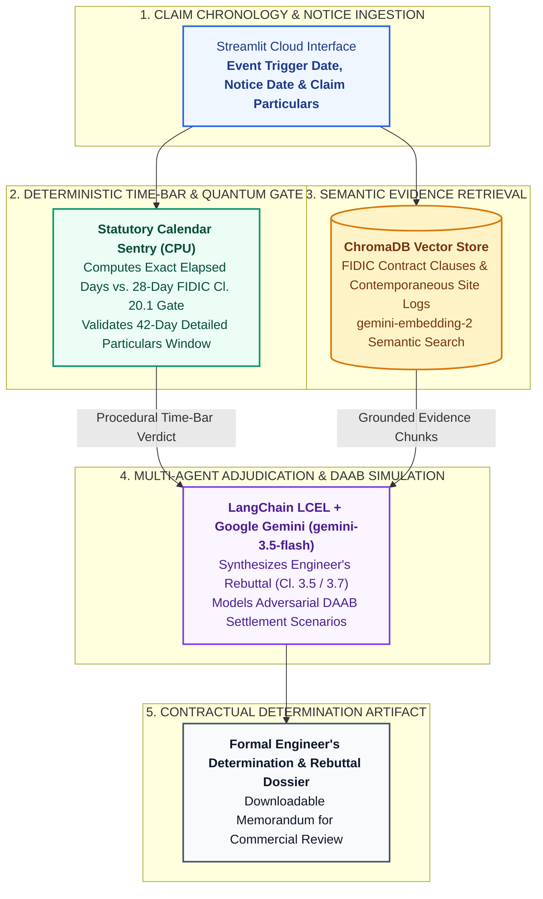

# Autonomous FIDIC Contract Claims & Time-Bar Engine

> **Dataset & Confidentiality Note:** This application is an independent engineering architecture demonstration validated on representative, anonymized project datasets.

---

### Executive Problem Statement
Under FIDIC 1999/2017 Red and Yellow Book contracts, strict procedural conditions precedent—most notably the **28-day notice time-bar under Sub-Clause 20.1 / 20.2**—determine whether a contractor's claim is valid or time-barred. Manual cross-referencing of notice chronologies against thousands of pages of site correspondence and baseline logs often results in missed procedural defenses or costly arbitration.

### Operational Value
* **Early Procedural Defense:** Deterministically audits event awareness dates against formal notice dates to flag fatal 28-day time-bar defaults immediately.
* **Evidence-Grounded Rebuttals:** Retrieves contemporaneous site records and contract clauses via ChromaDB Vector RAG to prevent unsupported LLM citations.
* **Structured Determination Drafting:** Models Dispute Avoidance/Adjudication Board (DAAB) positions and drafts formal Engineer's Determinations under Sub-Clause 3.5 / 3.7 for human review.

---

### System Architecture

---

### Technology Stack
* **Runtime & UI:** Python 3.12, Streamlit Community Cloud
* **Vector Database & Retrieval:** ChromaDB, Google `gemini-embedding-2`
* **Orchestration & Validation:** LangChain LCEL, Google `gemini-3.5-flash`, Pydantic v2

### Author & Architect
**Rohit Kumar, PMP, CEng, CEA, FSEr (TÜV)**  
Cross-Technology Technical Architect | Mission-Critical Infrastructure & Applied AI Solutions  
[LinkedIn](https://www.linkedin.com/in/rohitg41) | [Live Application](https://rohitkumarg-fidic-engine.streamlit.app)

---

### Enterprise Advisory & Custom Architecture
Available for technical consulting, custom agentic workflow development, and private enterprise deployments.  
**Connect:** [LinkedIn](https://www.linkedin.com/in/rohitg41) | **Email:** `grohit41@gmail.com`

---

### Intellectual Property & Licensing
**Copyright © 2026 Rohit Kumar. All Rights Reserved.**  
This repository and its source code are published solely for technical portfolio evaluation and architectural demonstration. Unauthorized copying, redistribution, or commercial deployment is prohibited without prior written consent.
